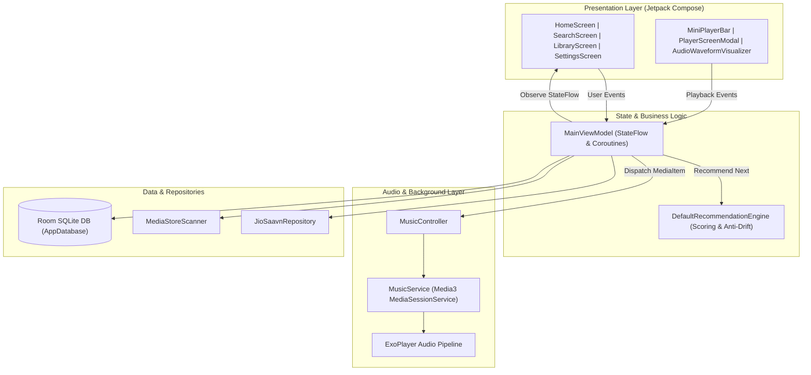

# 🎵 Ranjha Music (Pulse Music)

<div align="center">

<h1>🎶 Ranjha Music</h1>
<p><strong>Next-Generation Intelligent Streaming & Local Music Player for Android</strong></p>

[](https://developer.android.com)
[](https://kotlinlang.org)
[](https://developer.android.com/jetpack/compose)
[](https://developer.android.com/media/media3)
[-brightgreen?style=for-the-badge)](https://github.com/deepanshu383/pulse-music-)
[](LICENSE)

<br/>

**Ranjha Music** is a native Android music streaming and local audio player combining high-bitrate cloud streaming (JioSaavn API), full local storage integration (MediaStore/SAF), an intelligent 7-factor anti-drift recommendation engine, and a fluid glassmorphic Jetpack Compose interface with Material You dynamic theming.

</div>

---

## 📑 Table of Contents
- [✨ Key Features](#-key-features)
- [🏗️ System Architecture](#️-system-architecture)
- [🌐 Cloud API & Data Sources](#-cloud-api--data-sources)
- [🧠 Recommendation & Anti-Drift Engine](#-recommendation--anti-drift-engine)
- [📱 Core UI & Glassmorphism](#-core-ui--glassmorphism)
- [🗄️ Database & Storage Model](#️-database--storage-model)
- [🚀 Getting Started & Build Instructions](#-getting-started--build-instructions)
- [🧪 Testing & Verification](#-testing--verification)
- [📄 License & Credits](#-license--credits)

---

## ✨ Key Features

### 1. 🎧 Universal Audio Playback (Every Source)
- **Zero Storage Friction**: Flawlessly resolves and plays audio from any source:
  - Local filesystem storage (`/storage/emulated/0/...`, MediaStore paths)
  - Direct file URIs (`file://`) and Storage Access Framework URIs (`content://`)
  - Offline cached downloads (`localDownloadPath`)
  - Remote CDN streaming links (`http://`, `https://`)
- **Auto-Recovery on Expired Tokens**: Intercepts HTTP 403 / IO expired CDN URLs during playback, re-fetches fresh stream tokens from JioSaavn, and resumes smoothly without audio dropouts.
- **Background Foreground Service**: Powered by **AndroidX Media3 ExoPlayer** and `MediaSessionService` with lockscreen controls, notification media controls, and audio focus ducking.

### 2. 🧠 Smart 7-Factor Recommendation Engine
- **Anti-Drift Session Locking**: Locks into the user's initial mood group (*Romantic*, *Party*, *Sad*, *Chill*); conflicting tracks receive a hard filter score of `-9999.0` and are strictly excluded.
- **Canonical Deduplication**: Strips track variations (`(Remix)`, `(Lofi Mix)`, `[Acoustic]`, `- Reprise`) so the queue never plays duplicate versions of the same song.
- **Strict Language & Era Consistency**: Hindi tracks won't jump into cross-regional genres; legacy loops (pre-2010) strictly block modern remix intrusion.
- **Devotional Content Filter**: Automatically isolates bhajans, aartis, and kirtans from secular pop/party queues.

### 3. 🎨 Glassmorphic UI & Dynamic App Icon
- **Cyberpunk Dark Theme**: Deep navy background (`#01012B`), neon pink accents (`#FF2A6D`), and electric cyan highlights (`#05D9E8`).
- **Material You Dynamic Launcher Icon**: Android 13+ adaptive monochrome launcher icon (`ic_launcher_monochrome.xml`) that morphs color palettes dynamically with the user's phone wallpaper.
- **Live Waveform Visualizer**: `AudioWaveformVisualizer` animates smoothly on active playing songs across Home, Search, Playlists, and Library screens.
- **Persistent Bottom Navigation**: Main navigation bar remains accessible across all screens, only retracting when the full-screen player modal expands.

### 4. 🔍 Spotify-Style Search & Recent History
- Real-time debounced search for songs, albums, artists, and playlists.
- Tap-to-play with live waveform state right inside the search results.
- Interactive search history: tap previous queries to replay instantly or swipe to remove.

### 5. 📂 Offline Downloads & Queue Management
- Native high-speed background downloader storing 320 kbps MP4/AAC files in public music storage.
- Auto-add next songs toggle and queue persistence across app sessions.

---

## 🏗️ System Architecture

The application strictly adheres to **MVVM (Model-View-ViewModel)** with Unidirectional Data Flow (UDF) and Clean Architecture principles:



---

## 🌐 Cloud API & Data Sources

| Data Source | Type | Description |
| :--- | :--- | :--- |
| **JioSaavn API** | REST API | Multi-bitrate audio streams (320kbps, 160kbps, 96kbps), song search, playlists, and album art. |
| **Android MediaStore** | Local Content Provider | Scans device music directories (`/storage/emulated/0/...`) for MP3, FLAC, AAC, WAV, and M4A. |
| **Storage Access Framework (SAF)** | Local File System | Custom folder picker supporting user-selected SD card/internal directories. |
| **Room SQLite (`pulse_music_db`)** | Local Database | Caches songs, custom playlists, playback history, track feature vectors, and download metadata. |
| **Firebase Auth & Firestore** | Cloud Backend | Google Sign-In and cloud playlist synchronization across devices. |

---

## 🧠 Recommendation & Anti-Drift Engine

Every candidate track is scored in real time using the following weighted multi-factor equation:

$$\text{Total Score} = \sum (\text{Factor Score} \times \text{Weight}) - \text{Fatigue Penalty} + \text{Exploration Jitter}$$

```
                          CANDIDATE TRACK POOL (50 Songs)
                                         │
                                         ▼
             ┌───────────────────────────────────────────────────────┐
             │         ZERO-TOLERANCE HARD FILTERS (0% Bypass)       │
             │  • Devotional Exclusion Filter (Bhajan / Aarti / God) │
             │  • Canonical Key Dedup ("title|artist" normalized)    │
             │  • Active Session Replay & Early Skip Guard           │
             │  • Strict Language Consistency Check                  │
             │  • Anti-Drift Mood Group Lock                         │
             └───────────────────────────┬───────────────────────────┘
                                         │
                                         ▼
             ┌───────────────────────────────────────────────────────┐
             │            MULTI-FACTOR SCORING ENGINE                │
             │  • Mood Consistency (30%)    • Acoustic Similarity (10%)│
             │  • Language Match (25%)      • Category/Movie Single (10%)│
             │  • Era Proximity (20%)       • Time of Day Fit (5%)   │
             │  • User Preference (+10%)    • Jitter Randomizer      │
             └───────────────────────────┬───────────────────────────┘
                                         │
                                         ▼
                            WINNING TRACK ENQUEUED
```

- **Weights Breakdown**:
  - **Mood Consistency (30%)**: Matches the emotional mood group (Party, Romantic, Sad, Chill).
  - **Language Consistency (25%)**: Strictly preserves session language with soft cross-affinity (Hindi ↔ Urdu).
  - **Era Proximity (20%)**: Enforces a $\pm 5$-year window around the current track.
  - **Acoustic Similarity (10%)**: Matches vocal timbres and tempo clusters.
  - **Category Consistency (10%)**: Pairs movie soundtrack songs with soundtracks, and independent singles with singles.
  - **User Preference (10%)**: Rewards user ratings, favorite artists, and manual picks.
  - **Time of Day (5%)**: Adapts to user habits (energetic in afternoon, chill/acoustic at night).

---

## 📱 Core UI & Glassmorphism

| Screen | Description |
| :--- | :--- |
| **Home Screen** | Discover tab with horizontal carousels for trending hits, top charts, and curated playlists. |
| **Search Screen** | Instant search with debounced queries, live waveform audio previews, and Spotify-style history chips. |
| **Library Screen** | Grid/List view of local and online playlists, sorting by title, artist, date added, or duration. |
| **Playlist Details** | Dynamic playlist header, drag-and-drop song reordering, and instant tap-to-toggle playback. |
| **Artist Profile** | Artist banner, follower statistics, biography snippet, top tracks, and complete discography. |
| **Player Modal** | Full-screen immersive player featuring rotating vinyl/cover art, waveform visualizer, and lyrics card. |
| **Mini-Player Bar** | Persistent bottom control dock visible above the navigation bar across all sub-screens. |
| **Settings Screen** | Folder selector, storage rescan, auto-play next track toggle, and theme switching. |

---

## 🗄️ Database & Storage Model

### Local SQLite (Room Database: `pulse_music_db`)
1. **`songs`**: Master cache table storing file paths, titles, artists, albums, durations, stream URLs, download flags, and cover artwork.
2. **`playlists`**: User playlists with names, descriptions, cover paths, and creation timestamps.
3. **`playlist_song_cross_ref`**: Relational join table mapping songs to playlists with explicit position ordering indices.
4. **`playback_history`**: Chronological log of played songs, timestamps, and canonical keys for 7-day fatigue calculations.
5. **`search_history`**: Stores recent search queries and clicked songs for instant recall.

---

## 🚀 Getting Started & Build Instructions

### Prerequisites
- **Android Studio**: Iguana (2023.2.1) or newer / Ladybug
- **JDK**: OpenJDK 17 or 21
- **Android SDK**: API 34 (Target: Android 14/15/16)
- **Build System**: Gradle 8.4+ with Kotlin 1.9.22

### Clone & Build
```bash
# 1. Clone the repository
git clone https://github.com/deepanshu383/pulse-music-.git
cd pulse-music-

# 2. Build Debug APK
./gradlew assembleDebug

# 3. Install to connected device via ADB
adb install -r app/build/outputs/apk/debug/app-debug.apk

# 4. Launch the application
adb shell am start -n pulse.music/com.example.MainActivity
```

---

## 🧪 Testing & Verification

The project includes an automated unit test suite covering recommendation math, anti-drift constraints, and deduplication logic:

```bash
# Run all unit tests
./gradlew testDebugUnitTest
```

### Test Coverage Highlights
- `RecommendationEngineTest`: Validates language hard-filtering, era proximity penalties, and multi-version canonical deduplication.
- `VerificationTest`: Verifies stochastic exploration jitter and zero-tolerance devotional filtering.
- `EngineStressTest`: 30-step simulation runs across 1,000+ synthetic tracks ensuring zero drift and zero infinite loops.
- **Test Status**: **31 Tests Completed, 0 Failures (100% Pass Rate)**.

---

## 📄 License & Credits

- Developed with ❤️ by **[Deepanshu](https://github.com/deepanshu383)**.
- Streaming API powered by the open JioSaavn catalog.
- Built with **Kotlin**, **Jetpack Compose**, and **AndroidX Media3**.
- Licensed under the [Apache 2.0 License](LICENSE).
